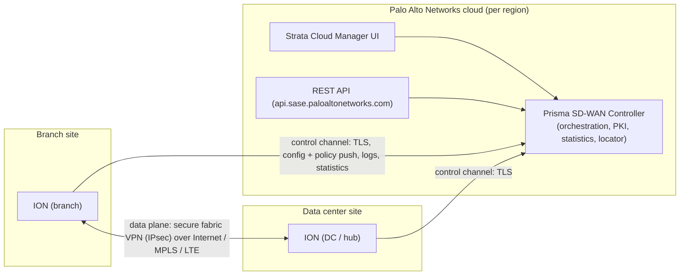

# Architecture, controller, ION, and the three planes

Domain: 1 (Fundamentals) | Applies to: cloud-managed Prisma SD-WAN, ION 6.x, Strata Cloud Manager (SCM) | Status: DOCUMENTED | Last updated: 2026-10-08

## Explanation (plain words)

Prisma SD-WAN has two parts. A **controller** that lives in the Palo Alto Networks cloud (or, for regulated customers, on the customer's own servers as the On-Premises Controller) and **ION devices** (Instant-On Network devices) that sit at branches and data centers and forward the traffic. The controller is the single place where configuration, policy, topology and monitoring live. The ION devices get their configuration from the controller and send statistics back. Administrators work in Strata Cloud Manager, the web interface, or through the REST API.

The product's own name for the resulting network is the **AppFabric**: the set of ION devices and the automatically built VPN tunnels between them, driven by application identity rather than by routing alone.

## Architecture

- **Management plane:** Strata Cloud Manager and the REST API. (Older documents call the portal "Cloud Manager"; see version notes.)
- **Control plane:** the controller. It programs policy and configuration onto ION devices and collects statistics. It is not in the packet path.
- **Data plane:** the ION devices. They identify applications, choose paths, apply policy and build the VPN tunnels among themselves.

The admin guide states the control and data planes are completely separated: a branch ION keeps working if it loses the controller, keeps its VPNs up, and keeps rotating per-tunnel session keys every hour for up to 72 hours.

## What the controller does (documented)

- Centralizes routing and builds a network of private and public WAN paths; single source of truth for ION configuration at branch and DC sites; central point for security policy and analytics; automated zero-touch VPN tunnels. Once a device is claimed, the controller overwrites any configuration made locally on the device through the console or device toolkit.
- Controller services run in regional compute regions (internal deck names three: "El Capitan" and "Hood" in the US, "Sugarloaf" in the EU) with per-tenant service isolation and an API-first design. Public status page: `https://sase.status.paloaltonetworks.com`.
- Internal deck lists controller components: orchestration service, PKI service (HSM-backed offline root CA; separate controller, manufacturing and tenant CAs), manufacturing service, locator service, statistics service; data sharded per customer, encrypted at rest, mirrored to a secondary region hourly.

## Device-to-controller channel (documented and internal)

- The ION reaches the controller through its controller port (Gen-1 devices) or any Layer 3 interface marked "Used for Controller" (Gen-2, from ION 6.3.1), over a DHCP-enabled network with Internet access. Transport is TLS to the controller on TCP 443 (stated in the on-premises controller guide for that deployment; same port is implied for cloud but not stated on the pages read).
- Internal deck: the device opens three logical connections to the controller: configuration (control and management), logs (syslog, VPN, route, TCP), and statistics (flow, path, interface, routing). If the channel is down the device shows Offline; it can keep operating for 3 days and buffer up to 3 days of statistics.

## Trust chain and VPN keys (documented in part, internal in detail)

- Each physical ION carries a Manufacturer Installed Certificate (MIC) tied to its serial number and a TPM. Claiming a device makes the controller issue a tenant-specific Claim Installed Certificate (CIC); the TLS session is re-established with the CIC. Until claimed, the device is "quarantined": visible as Unclaimed, cannot receive policy or talk to other IONs.
- VPN keys (internal deck): the controller distributes three encrypted shared secrets, each valid one day; endpoints exchange nonces and derive per-tunnel session keys, renegotiated hourly without the controller. Devices can keep establishing IPsec VPNs for 3 days without the controller. The official admin guide gives the customer-safe version: session keys rotate hourly for up to 72 hours without controller connectivity.

## Prerequisites and dependencies

- Active Prisma SD-WAN license on a tenant (tenant service group) in a supported region; see note 03.
- Internet reachability from the ION controller interface to the controller; DHCP available for zero-touch provisioning (static IP possible through the AUX console port).

## Documented configuration pointers

- Device access, claim, assign: see note 08.
- Site creation: see note 06.

## Expected behavior

- Controller loss does not stop forwarding; it stops configuration changes and live statistics upload until the channel returns (internal: statistics buffered up to 3 days).
- Local CLI or toolkit configuration is overwritten by the controller after claim (official).

## Verification

- Device state on the Devices page: Unclaimed/Offline, Unclaimed/Online-Restricted (virtual), Claimed/Online (official, admin guide pp. 140–143).
- Dashboard widget "Device To Controller Connectivity" shows Online and Offline counts per branch and DC (admin guide p. 30).
- Related CLI listed by the admin guide for controller connectivity: `dump controller status`, `debug controller reachability`, `inspect connection`, `clear connection` (names only; syntax to be confirmed in batch B18 against the CLI reference and release notes).

## Limitations and gotchas

- The internal "3 days" and "three connections" details come from a Feb 2026 TME deck; the official guide only states 72 hours of key rotation. Do not quote the finer details to customers without the official source.
- "Cloud Manager" in older solution guides refers to the legacy CloudGenix portal; the current interface is Strata Cloud Manager.

## Version notes

- Used-for-Controller on any Layer 3 interface: Gen-2 devices from ION 6.3.1 (admin guide p. 183).
- FIPS-CC mode from release 6.5.1 requires the On-Premises Controller (internal best-practices guide WS-001).

## Claims register

| Claim | Label | Evidence | Source pointer |
|---|---|---|---|
| Two key elements: controller and ION devices; controller is single source of truth and overwrites local config after claim | VERIFIED | DOC | SRC-000029 p.12 (Admin Guide, rev 2025-05-13) |
| Complete separation of control and data planes; ION keeps VPNs and rotates session keys hourly for up to 72 h without the controller | VERIFIED | DOC | SRC-000029 p.57 |
| Three deployment modes: Analytics, Control, Disabled | VERIFIED | DOC | SRC-000029 p.11; WS-001 §Deployment and Operational Modes (v2.0, 2026-05-30) |
| Controller releases are pushed by Palo Alto Networks with notice; ION software upgrades are the customer's responsibility | VERIFIED | DOC | SRC-000029 p.14 |
| Status page `sase.status.paloaltonetworks.com` | VERIFIED | DOC | SRC-000029 p.14 |
| Gen-2 devices can use any L3 interface as controller port (Used-for-Controller) from 6.3.1; Gen-1 (2000, 3000, 7000, 9000) have a dedicated controller port | VERIFIED | DOC | SRC-000029 p.183 |
| Device opens three connections (config, logs, statistics); offline device operates 3 days and buffers 3 days of statistics | UNVERIFIED (internal) | DOC | WS-033 slide 31 notes (TME deck, Feb 2026) |
| Three compute regions (El Capitan, Hood, Sugarloaf); controller components (orchestration, PKI, manufacturing, locator, statistics) | UNVERIFIED (internal) | DOC | WS-033 slides 32, 484, 485 |
| MIC/CIC/TPM chain of trust; claim issues tenant certificate; TLS 1.2 | CORROBORATED (official admin guide p.143 says customer-specific certificates download at claim; details internal) | DOC | SRC-000029 p.143; WS-033 slide 39 |
| Three one-day shared secrets, hourly session-key renegotiation without controller, 3-day independence | UNVERIFIED (internal); the 72 h figure is VERIFIED | DOC | WS-033 slide 40; SRC-000029 p.57 |
| FIPS 140-2/140-3 baseline; FIPS-CC mode from 6.5.1 needs On-Premises Controller | UNVERIFIED (internal, strong) | DOC | WS-001 §Hardware Selection; SRC-000031 p.6 says "built with FIPS 140-3 as a security baseline" (VERIFIED for the baseline statement) |
| Controller TCP 443 from ION (on-premises controller) | VERIFIED for on-prem only | DOC | WS-044 p.7 (rev 2025-06-12) |

## Open questions (copied to 04)

- KG-060: official statement of the ION-to-cloud-controller ports and destinations (for firewall allow-lists) not yet located; the admin guide has "Allow IP Addresses in Firewall Configuration" at p.155 (to read in B3/B18).
- KG-061: official confirmation of the "3 days of statistics buffering" claim.
